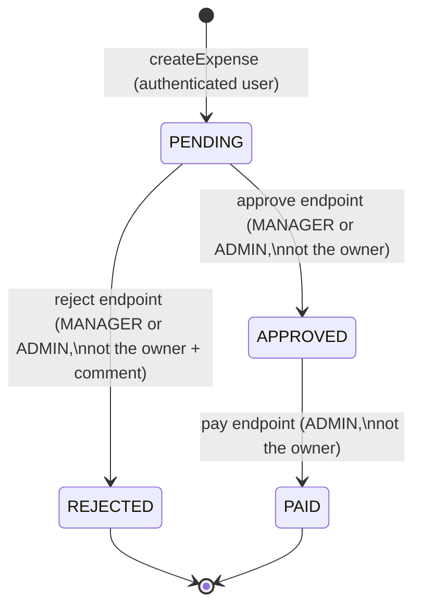

# SVCORA_SpendX Approval Workflow

## Overview

1. An authenticated user creates an expense in `PENDING`.
2. A MANAGER or ADMIN can approve another user's pending expense.
3. A MANAGER or ADMIN can reject another user's pending expense with a comment.
4. Only an ADMIN can pay another user's approved expense.
5. `REJECTED` and `PAID` are terminal statuses in the current transition code.

Evidence: `createExpense`, `approveExpense`, `rejectExpense`, and `payExpense` in `server/controllers/expenseController.js`; `EXPENSE_STATUS` in `server/constants/expenseStatus.js`.

## State diagram

Evidence: `server/routes/expenseRoutes.js` and the transition handlers in `server/controllers/expenseController.js`.

## Transition table

| From | To | Endpoint | Allowed roles | Extra conditions | Violation status |
|---|---|---|---|---|---|
| none | `PENDING` | `POST /api/expenses` | Any authenticated role | `amount`, `description`, `category`, and a valid `date` are required. `userId` comes from `req.user.id`. | `401` without a token; `400` for invalid input |
| `PENDING` | `APPROVED` | `PATCH /api/expenses/:id/approve` | MANAGER, ADMIN | The expense must exist, must not belong to the caller, and must still be `PENDING`. | `401`, `403`, `404`, or `409` |
| `PENDING` | `REJECTED` | `PATCH /api/expenses/:id/reject` | MANAGER, ADMIN | The expense must exist, must not belong to the caller, must still be `PENDING`, and `comment` must be a non-empty trimmed string. | `400`, `401`, `403`, `404`, or `409` |
| `APPROVED` | `PAID` | `PATCH /api/expenses/:id/pay` | ADMIN | The expense must exist, must not belong to the caller, and must still be `APPROVED`. | `401`, `403`, `404`, or `409` |

`requireRole` returns `403` for a role outside the route's allowed list. `authenticateUser` returns `401` when the bearer token is missing, invalid, expired, or references no user. Evidence: `server/middlewares/requireRole.js`, `server/middlewares/authenticateUser.js`.

## Happy path

1. **Employee submits:** On `/addclaims`, `AddClaims` sends `POST /api/expenses`. The backend `createExpense` stores the expense as `PENDING`.
2. **Employee views it:** `/claims` calls `useExpenses({ scope: "mine" })`. `Claims` renders the employee's own claim with its status. `ClaimCard` does not show approval or payment actions there.
3. **Manager reviews:** `/approvals` is available to MANAGER and ADMIN through `RoleRoute`. `Approvals` requests all `PENDING` expenses and renders `ClaimCard` with actions. The manager sees **Approve** and **Reject** only for another user's pending claim.
4. **Manager approves:** Clicking **Approve** calls the approve mutation in `useExpenses`, which sends the approve endpoint. `approveExpense` changes the claim to `APPROVED`.
5. **Finance observes:** FINANCE can use `/all-claims` and the Dashboard. `AllClaims` is read-only and shows all statuses; FINANCE has no Approvals or Payments navigation.
6. **Admin pays:** `/payments` is ADMIN-only. `Payments` lists approved and paid claims. For an approved claim owned by someone else, `ClaimCard` shows **Process payment**. The pay mutation sends the pay endpoint and changes the claim to `PAID`.

Evidence: `client/src/pages/AddClaims.tsx` (`handleSubmit`), `client/src/hooks/useExpenses.ts` (`useExpenses`, `useApproveExpense`, `usePayExpense`), `client/src/pages/Claims.tsx`, `client/src/pages/Approvals.tsx`, `client/src/pages/AllClaims.tsx`, `client/src/pages/Payments.tsx`, `client/src/components/claims/ClaimCard.tsx`, `client/src/App.tsx`, and `client/src/components/layout/DashboardLayout.tsx`.

## Reject path

1. A MANAGER or ADMIN opens `/approvals` and clicks **Reject** on another user's pending claim.
2. `Approvals` opens a dialog requiring a non-empty rejection comment.
3. Confirming sends `PATCH /api/expenses/:id/reject` with `{ comment }`.
4. `rejectExpense` stores `REJECTED`, the reviewer ID, review time, and the trimmed comment.
5. The employee sees the rejected status and rejection reason on `/claims` through `ClaimCard`.
6. FINANCE can see the rejected claim in `/all-claims`, but cannot approve, reject, or pay it.

Evidence: `Approvals` (`submitRejection`), `useRejectExpense`, `rejectExpense`, `Claims`, `AllClaims`, and `ClaimCard`.

## Data written at each step

| Step | Fields written |
|---|---|
| Create | `amount`, `description`, `category`, `date`, and `userId`; `status` defaults to `PENDING`. |
| Edit while pending | Owner-editable `amount`, `description`, `category`, and/or `date`. |
| Approve | `status = APPROVED`, `reviewedById = req.user.id`, `reviewedAt = new Date()`, `reviewComment = null`. |
| Reject | `status = REJECTED`, `reviewedById = req.user.id`, `reviewedAt = new Date()`, `reviewComment = comment`. |
| Pay | `status = PAID`, `paidById = req.user.id`, `paidAt = new Date()`. |
| Delete | The `Expense` row is removed. |

Evidence: `createExpense`, `updateExpense`, `approveExpense`, `rejectExpense`, `payExpense`, and `deleteExpense` in `server/controllers/expenseController.js`; fields are defined in `server/prisma/schema.prisma`.

## Visibility rules

The backend `getExpenses` handler applies `scope=mine` before role-based visibility. EMPLOYEE always sees only their own expenses. MANAGER, FINANCE, and ADMIN see all expenses without `scope=mine`. A valid `status` query narrows the result; an unknown scope value is ignored. Evidence: `getExpenses` in `server/controllers/expenseController.js` and `useExpenses` in `client/src/hooks/useExpenses.ts`.

| Area | EMPLOYEE | MANAGER | FINANCE | ADMIN |
|---|---|---|---|---|
| My Claims (`/claims`) | Own claims; read-only status/details | Own claims only; read-only | Own claims only; read-only | Own claims only; read-only |
| All Claims (`/all-claims`) | Not routed | All claims, read-only | All claims, read-only | All claims, read-only |
| Approvals (`/approvals`) | Not routed | All pending claims; approve/reject other users' claims | Not routed | All pending claims; approve/reject other users' claims |
| Payments (`/payments`) | Not routed | Not routed | Not routed | Approved and paid claims; pay approved claims owned by others |
| Dashboard (`/dashboard`) | Own stats and recent claims | Own stats plus company-wide Team overview | Own stats plus company-wide Team overview | Own stats plus company-wide Team overview |

`Dashboard` uses `scope=mine` for personal data and `scope=all` for the privileged Team overview. `DashboardLayout` uses `scope=mine` for the My Claims badge. Evidence: `Claims`, `AllClaims`, `Approvals`, `Payments`, `Dashboard`, and `DashboardLayout`.

## Edit and delete rules

- `PUT /api/expenses/:id` first loads the expense and requires `expense.userId === req.user.id`; otherwise it returns `403`.
- Only `PENDING` expenses can be edited. Other statuses return `409`.
- Workflow fields (`status`, review fields, and payment fields) are rejected with `400`; the endpoint cannot change status.
- `DELETE /api/expenses/:id` allows the owner to delete a pending claim.
- ADMIN can delete any existing expense regardless of owner or status.
- Non-ADMIN owners cannot delete a non-pending expense; that returns `409`.
- A non-owner non-ADMIN receives `403`.

Evidence: `updateExpense` and `deleteExpense` in `server/controllers/expenseController.js`; the routes are registered in `server/routes/expenseRoutes.js`.

## Edge cases verified in code

- **Self-approval:** MANAGER and ADMIN are blocked from approving or rejecting their own claims by `findTransitionExpense`. FINANCE cannot reach those endpoints because `requireRole` allows only MANAGER and ADMIN.
- **Self-payment:** ADMIN is blocked from paying their own claim by `findTransitionExpense`. FINANCE cannot pay because the pay route is ADMIN-only.
- **Who can act on a manager's or admin's claim:** Another MANAGER or ADMIN can approve or reject it. Another ADMIN can pay it after approval. The code checks user ID, not the owner's role.
- **Only one ADMIN:** Role-management code is outside this workflow document's requested transition files. The expense workflow itself has no last-ADMIN check.
- **Concurrent approve/reject/pay:** There is a race risk. Each handler reads the expense, checks the status, then performs `prisma.expense.update({ where: { id } })`. The update does not include the expected status in its `where` clause and is not inside a transaction. Two requests can both pass the check; the later update can overwrite the earlier result.
- **Owner deleted:** There is no owner-deletion workflow in the requested frontend or expense routes. `Expense.userId` is a required relation in `schema.prisma`, and no `onDelete: Cascade` behavior is declared there. The application does not handle an orphaned owner.
- **Owner demoted:** Authentication reloads the user's current database role on each request. A demoted manager loses approval-route access, but existing expense review fields remain unchanged. The owner can still view their own claim through `scope=mine`.

Evidence: `findTransitionExpense`, the three transition handlers, `expenseRoutes.js`, `authenticateUser`, and `schema.prisma`.

## Not implemented

- **Notifications:** Dashboard notifications are static sample UI text; there is no notification model or notification endpoint in the reviewed code. Evidence: `Dashboard.tsx`, `schema.prisma`.
- **Receipts:** `AddClaims` selects files locally, but its request sends only amount, description, category, and date. `Expense` has no receipt field. Evidence: `AddClaims.tsx`, `createExpense`, `schema.prisma`.
- **Multi-level or amount-based approval:** Approval is controlled only by `requireRole('MANAGER', 'ADMIN')` and the current status. No amount threshold or approval level exists. Evidence: `expenseRoutes.js`, `schema.prisma`.
- **Resubmission of rejected claims:** `updateExpense` accepts edits only for `PENDING`; there is no resubmission endpoint or rejected-to-pending transition. Evidence: `updateExpense`, `expenseRoutes.js`, `EXPENSE_STATUS`.
- **Audit log:** No audit/history model or write path exists in the reviewed schema or expense controller. Evidence: `schema.prisma`, `expenseController.js`.
- **Escalation:** No escalation fields, timer, job, or endpoint exists in the reviewed code. Evidence: `schema.prisma`, `expenseController.js`.
- **Approver assignment (`managerId`):** The schema has reviewer fields written after action, but no assigned approver or `managerId`. Evidence: `schema.prisma`.
- **Payment references:** Payment records contain only `paidById` and `paidAt`; there is no payment reference field or input. Evidence: `schema.prisma`, `payExpense`.

## Bugs and risks

1. **High — non-atomic transitions:** Concurrent approve/reject/pay requests can pass the status check and overwrite one another. Fix: perform a conditional update using both the expense ID and expected current status, then return `409` when no row matches; or enforce the check and update in a transaction with suitable locking.
2. **Medium — broad manager visibility:** MANAGER sees every expense, not a team mapped to that manager. Fix: add an explicit team/ownership mapping and filter manager queries by that mapping.
3. **Medium — ADMIN can delete any claim in any status:** `deleteExpense` gives ADMIN an unconditional delete path after loading the row. Fix: restrict deletion to an explicit administrative policy, or retain immutable financial records and use a controlled void/archive operation.
4. **Low — no application handling for owner deletion:** The required owner relation has no documented deletion policy in the expense workflow. Fix: define and enforce a retention policy, such as blocking user deletion while expenses exist or explicitly archiving/reassigning them.

## Assumption check

- **Statuses are `PENDING`, `APPROVED`, `REJECTED`, `PAID`:** Correct.
- **MANAGER and ADMIN approve or reject:** Correct.
- **FINANCE and ADMIN pay:** Wrong. Only ADMIN can pay; FINANCE is read-only and the pay route is ADMIN-only.
- **Nobody can approve or pay their own claim:** Mostly correct. MANAGER and ADMIN cannot approve/reject their own claims, and ADMIN cannot pay their own claim. FINANCE cannot perform those actions at all.
- **Rejected claims cannot be edited or resubmitted:** Correct in the current backend. Rejected claims return `409` from the edit endpoint, and no resubmission endpoint exists.
